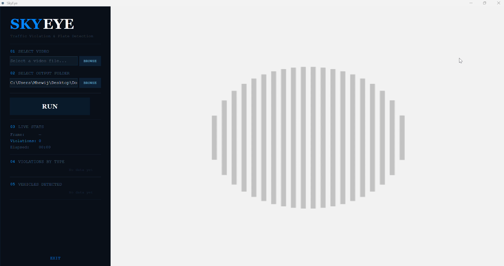
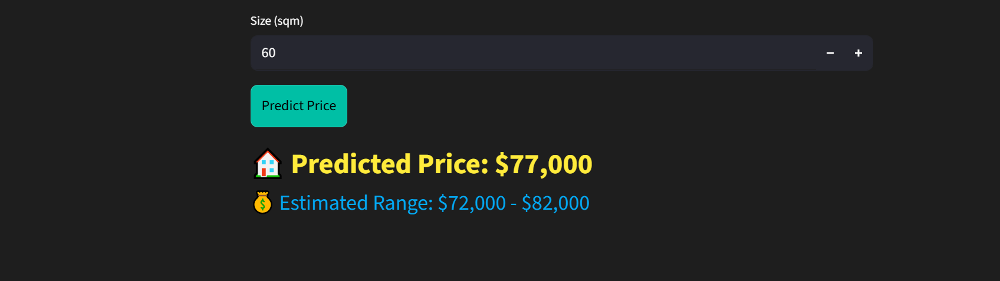

---
layout: default
title: Andre Joe Mhawej Portfolio
---

  

<h1 style="text-align: center; margin-top: 20px;">
  Artificial Intelligence & Machine Learning Developer
</h1>

  Explore my journey in AI projects, research, certifications, and academic excellence.

  

---

## Projects

<!-- FEATURED PROJECT: SKY EYE -->

  

    <h2 style="margin: 0;">SkyEye</h2>
    
      FEATURED PROJECT
    
  

  

    Real-Time AI Traffic Monitoring & Violation Detection
  

  

  

    An AI-powered traffic monitoring system developed using dual YOLOv8 models
    to detect multiple traffic violations in real time and automatically
    extract supporting evidence.
  

  

    Developed individually, covering data collection, annotation,
    preprocessing, model training, testing, and system implementation.
  

  

    The research paper was accepted for the 2026 IEEE International
    Conference on Intelligent Computing and Next-Generation Technologies
    (ICONET).
  

  
<strong>Technologies & Concepts:</strong>

  

    YOLOv8 · Computer Vision · Deep Learning · Object Detection ·
    Python · Real-Time Processing
  

  

  

    <a href="/assets/SkyEye.html"
       target="_blank" rel="noopener"
       style="background: #2563eb; color: white; padding: 11px 18px; border-radius: 7px; text-decoration: none; font-weight: bold;">
       Explore SkyEye
    </a>

    <a href="/assets/Andre%20Joe%20Mhawej%20Paper.pdf"
       target="_blank" rel="noopener"
       style="border: 1px solid #2563eb; color: inherit; padding: 11px 18px; border-radius: 7px; text-decoration: none; font-weight: bold;">
       Research Paper (PDF)
    </a>

    <!-- Add individual IEEE Xplore paper URL here when available -->

    <a href="#"
       style="border: 1px solid #888; color: inherit; padding: 11px 18px; border-radius: 7px; text-decoration: none; opacity: 0.6; pointer-events: none;">
       IEEE Xplore (Coming Soon)
    </a>

  

 

---

### University Assistant Chatbot

A personal AI assistant trained on my AI courses using embeddings and
Retrieval-Augmented Generation (RAG).

It can help you review materials, answer questions, and explore concepts interactively.

Feel free to try some prompts like:

- What is software engineering briefly?
- Explain what is LSTM.
- What is sentiment analysis?
- What is a while loop in Python?

  

<a href="https://andre-joe.github.io/University-Preview/"
   target="_blank" rel="noopener">
   💬 Try the Chatbot Now!
</a>

  

---

### Lebanon House Price Predictor

From data collection to model refining, this project predicts house prices in Lebanon.

The dataset was collected in September 2025, reflecting the market at that time.

  

  

<a href="https://andre-joe.github.io/House-Preview/"
   target="_blank" rel="noopener">
   💰 Predict Your Home Price Now!
</a>

  

---

## Certifications & Transcript

For a complete list of my Coursera certifications, visit my
<a href="https://www.coursera.org/user/b2be56243c7bbe7e10eecb1fac05bd18"
   target="_blank" rel="noopener">Coursera profile</a>.

  

My full academic transcript is available
<a href="/assets/transcript.pdf" target="_blank" rel="noopener">here</a>.

Curious about any topic or want more details from my courses?
Ask the chatbot in the Projects section.

  

---

## Contact Me

- Email: <a href="mailto:amhawej38@gmail.com" style="text-decoration:none; color:inherit;">amhawej38@gmail.com</a>
- Phone: <a href="tel:+96171679208" style="text-decoration:none; color:inherit;">+961 71 679 208</a>
