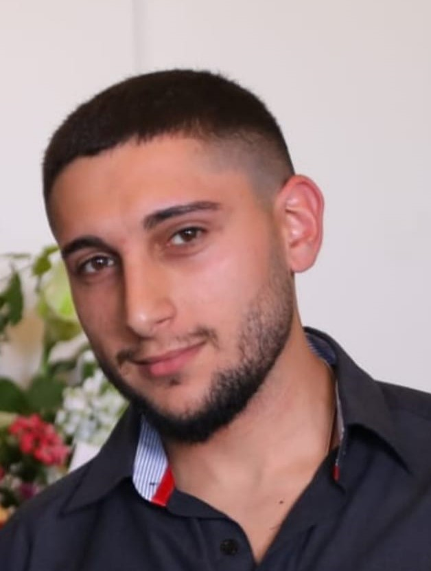
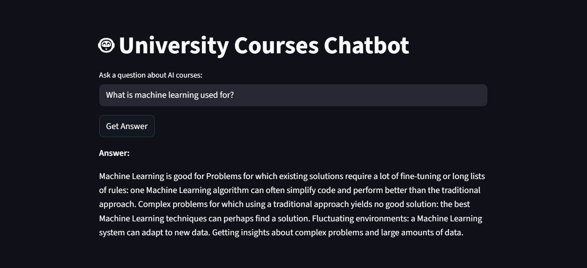

---
layout: default
title: Andre Joe Mhawej | AI & ML Developer
---

<!-- NAVIGATION -->

<nav class="navbar">
  
ANDRE.DEV

  

    <a href="#work">Projects</a>
    <a href="#skills">Skills</a>
    <a href="#credentials">Credentials</a>
    <a href="#contact" class="nav-contact">Let's Talk ↗</a>
  

</nav>

<!-- HERO -->

<section class="hero">

  

    

      
      AI / ML DEVELOPER
    

    <h1>
      Hello, I'm 
      Andre-Joe.
    </h1>

    

      I turn data into intelligence. I build AI-powered applications,
      computer vision systems, predictive models, and tools that solve
      real-world problems.
    

    

      ▋
    

    

      <a href="#work" class="btn btn-primary">Explore My Work ↓</a>
      <a href="#contact" class="btn btn-secondary">Contact Me ↗</a>
    

  

  

    

    

    

    
Python / AI

    
Computer Vision

  

</section>

<!-- MARQUEE -->

  

    ARTIFICIAL INTELLIGENCE
    MACHINE LEARNING
    COMPUTER VISION
    DEEP LEARNING
    PYTHON
    DATA SCIENCE
    ARTIFICIAL INTELLIGENCE
    MACHINE LEARNING
    COMPUTER VISION
    DEEP LEARNING
    PYTHON
    DATA SCIENCE
  

<!-- PROJECTS -->

<section class="section" id="work">

  

    

      
01 / SELECTED WORK

      <h2>Things I've Built.</h2>
    

    
From ideas to working systems.

  

  

    <!-- SKY EYE -->

    <article class="project-card featured reveal">
      

      

        

          PROJECT / 001
          ★ FEATURED PROJECT
        

        <h3>SkyEye — AI Traffic Intelligence</h3>

        

          A real-time traffic monitoring system built using dual YOLOv8
          models to detect multiple traffic violations and automatically
          extract supporting evidence.
        

        

          Developed individually, from data collection and annotation
          to preprocessing, model training, testing, and system implementation.
        

        

          Research paper accepted for the 2026 IEEE International Conference
          on Intelligent Computing and Next-Generation Technologies (ICONET).
        

        

          YOLOv8
          COMPUTER VISION
          DEEP LEARNING
          OBJECT DETECTION
          PYTHON
        

        

          <a class="project-link primary"
             href="/assets/SkyEye.html"
             target="_blank" rel="noopener">
            Explore Project ↗
          </a>

          <a class="project-link"
             href="/assets/Andre%20Joe%20Mhawej%20Paper.pdf"
             target="_blank" rel="noopener">
            Research Paper PDF ↗
          </a>
        

      

    </article>

    <!-- CHATBOT -->

    <article class="project-card reveal">
      

      

        

          PROJECT / 002
          AI APPLICATION
        

        <h3>University Assistant Chatbot</h3>

        

          A personal AI assistant built around my AI coursework.
          Using embeddings and Retrieval-Augmented Generation (RAG),
          it retrieves relevant material to answer questions and explain concepts.
        

        

          RAG
          EMBEDDINGS
          NLP
          PYTHON
        

        

          <a class="project-link primary"
             href="https://andre-joe.github.io/University-Preview/"
             target="_blank" rel="noopener">
            Try the Chatbot ↗
          </a>
        

      

    </article>

    <!-- HOUSE PREDICTOR -->

    <article class="project-card reveal">
      

      

        

          PROJECT / 003
          PREDICTIVE ML
        

        <h3>Lebanon House Price Predictor</h3>

        

          An end-to-end machine learning project using a dataset
          collected in September 2025 to predict property prices
          in the Lebanese real estate market.
        

        

          REGRESSION
          FEATURE ENGINEERING
          PANDAS
          DATA COLLECTION
        

        

          <a class="project-link primary"
             href="https://andre-joe.github.io/House-Preview/"
             target="_blank" rel="noopener">
            Try Predictor ↗
          </a>
        

      

    </article>

  

</section>

<!-- SKILLS -->

<section class="section" id="skills">

  

    

      
02 / TECHNICAL TOOLKIT

      <h2>My Toolkit.</h2>
    

    
Technologies and concepts I work with.

  

  

    

      Python
      PyTorch
      YOLOv8
      Computer Vision
      Scikit-learn
      Pandas
      NumPy
      RAG
      Embeddings
      LLMs
      NLP
      LSTM
      Regression
      Classification
      Data Visualization
      Statistics
      Feature Engineering
      Google Colab
    

  

</section>

<!-- PROFILE -->

<section class="section">

  

    

      
03 / A LITTLE ABOUT ME

      <h2>Beyond the Code.</h2>
    

  

  

    

      
🧠

      <h3>How I Think</h3>
      

        I enjoy breaking down complex problems, working with data,
        experimenting with models, and turning technical ideas
        into practical applications.
      

    

    

      
⚙️

      <h3>How I Work</h3>
      

        I value hands-on learning, independent problem-solving,
        experimentation, and understanding how systems work
        beyond simply using existing tools.
      

    

  

</section>

<!-- CREDENTIALS -->

<section class="section" id="credentials">

  

    

      
04 / EDUCATION & ACHIEVEMENTS

      <h2>Credentials.</h2>
    

    
Learning, research, and academic background.

  

  

    <a class="credential"
       href="https://www.coursera.org/user/b2be56243c7bbe7e10eecb1fac05bd18"
       target="_blank" rel="noopener">
      

        <strong>Coursera Certifications</strong>
        <small>Explore my courses and certificates</small>
      

      ↗
    </a>

    <a class="credential"
       href="/assets/transcript.pdf"
       target="_blank" rel="noopener">
      

        <strong>Academic Transcript</strong>
        <small>University academic record · PDF</small>
      

      ↗
    </a>

    <a class="credential"
       href="https://github.com/Andre-Joe/Andre-Joe.github.io"
       target="_blank" rel="noopener">
      

        <strong>GitHub Repository</strong>
        <small>Source code and portfolio website</small>
      

      ↗
    </a>

  

</section>

<!-- CONTACT -->

<section class="contact-section reveal" id="contact">

  
05 / GET IN TOUCH

  <h2>Have a project in mind?</h2>

  

    Interested in AI, machine learning, or computer vision?
    Let's connect.
  

  <a class="contact-email"
     href="mailto:amhawej38@gmail.com">
    amhawej38@gmail.com ↗
  </a>

  

    +961 71 679 208
    BEIRUT, LEBANON
    OPEN TO OPPORTUNITIES
  

</section>

<footer class="footer">
  ©  ANDRE-JOE MHAWEJ · BUILT WITH HTML, CSS & JS
</footer>

