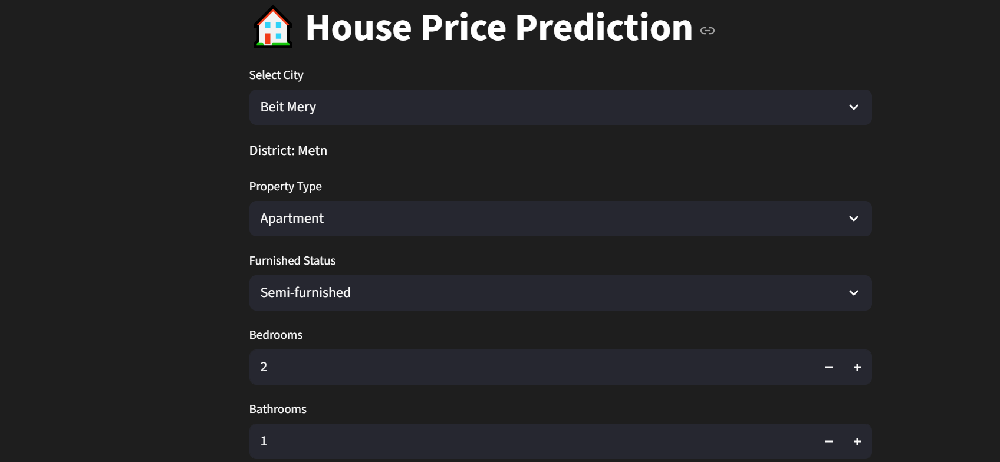

<!DOCTYPE html>
<html lang="en">
<head>
  <meta charset="UTF-8">
  <meta name="viewport" content="width=device-width, initial-scale=1.0">
  <meta name="description" content="Andre Joe Mhawej — Engineer specializing in Artificial Intelligence and Computer Vision.">
  <meta name="theme-color" content="#08090d">

  <title>Andre Joe Mhawej | AI & Computer Vision</title>

  <link rel="preconnect" href="https://fonts.googleapis.com">
  <link rel="preconnect" href="https://fonts.gstatic.com" crossorigin>
  <link href="https://fonts.googleapis.com/css2?family=DM+Mono:wght@400;500&family=Space+Grotesk:wght@400;500;600;700&display=swap" rel="stylesheet">

  
</head>

<body>

  

  

  <canvas id="particles"></canvas>
  

  <!-- NAVIGATION -->

  <header class="navbar" id="navbar">
    <nav class="nav-inner">
      <a href="#home" class="logo">ANDRE-JOE</a>

      <button class="menu-toggle" id="menuToggle" aria-label="Toggle navigation">
        ☰
      </button>

      <ul class="nav-links" id="navLinks">
        <li><a href="#home">Home</a></li>
        <li><a href="#projects">Projects</a></li>
        <li><a href="#skills">Skills</a></li>
        <li><a href="#credentials">Credentials</a></li>
        <li><a href="#contact" class="nav-contact">Contact</a></li>
      </ul>
    </nav>
  </header>

  <main>

    <!-- HERO -->

    <section class="hero" id="home">
      

        

          

            
            AI & COMPUTER VISION DEVELOPER
          

          <h1>
            Hello, I'm 
            Andre-Joe.
          </h1>

          

            I build intelligent systems using Artificial Intelligence and
            Computer Vision, from real-time object detection to practical
            applications that solve real-world problems.
          

          

            
          

          

            <a href="#projects" class="btn btn-primary">
              Explore My Work ↗
            </a>

            <a href="#contact" class="btn btn-outline">
              Get In Touch
            </a>
          

        

        

          

            

            

            
          

        

      

    </section>

    <!-- TECHNOLOGY MARQUEE -->

    

      

        ARTIFICIAL INTELLIGENCE
        COMPUTER VISION
        DEEP LEARNING
        OBJECT DETECTION
        YOLOv8
        PYTHON

        ARTIFICIAL INTELLIGENCE
        COMPUTER VISION
        DEEP LEARNING
        OBJECT DETECTION
        YOLOv8
        PYTHON
      

    

    <!-- PROJECTS -->

    <section class="section" id="projects">
      

        

          01 /
          <h2>Selected Projects</h2>
        

        

          A selection of projects where I apply engineering, programming,
          and intelligent technologies to solve practical problems.
        

        

          <!-- SKY EYE -->

          <article class="project-card reveal">
            

              
            

            

              
FEATURED PROJECT / COMPUTER VISION

              <h3>SkyEye</h3>

              

                A real-time traffic monitoring system designed to detect
                multiple traffic violations using two YOLOv8 models.
                The system processes road-camera footage and automatically
                extracts evidence, reducing the need for continuous manual
                monitoring.
              

              

                Python
                YOLOv8
                Computer Vision
                Deep Learning
                Object Detection
              

              

                <a href="/assets/SkyEye.html" target="_blank" rel="noopener">
                  Explore the System ↗
                </a>

                <a href="/assets/Andre%20Joe%20Mhawej%20Paper.pdf" target="_blank" rel="noopener">
                  Read Research Paper ↗
                </a>
              

            

          </article>

          <!-- CHATBOT -->

          <article class="project-card reveal">
            

              
            

            

              
AI APPLICATION

              <h3>AI Chatbot</h3>

              

                A web-based chatbot application that provides an interactive
                conversational experience through an AI-powered interface.
              

              

                Artificial Intelligence
                Python
                Web Development
              

              

                <a href="https://andre-joe.github.io/University-Preview/" target="_blank" rel="noopener">
                  Chat with the Bot ↗
                </a>
              

            

          </article>

          <!-- HOUSE PRICE PREDICTOR -->

          <article class="project-card reveal">
            

              
            

            

              
MACHINE LEARNING APPLICATION

              <h3>House Price Predictor</h3>

              

                A predictive application that estimates house prices based
                on property-related information, demonstrating the use of
                data and machine learning for practical prediction tasks.
              

              

                Machine Learning
                Python
                Prediction
              

              

                <a href="https://andre-joe.github.io/House-Preview/" target="_blank" rel="noopener">
                  Predict a House Price ↗
                </a>
              

            

          </article>

        

      

    </section>

    <!-- SKILLS -->

    <section class="section" id="skills">
      

        

          02 /
          <h2>Technical Skills</h2>
        

        

          Technologies and areas I work with across Artificial Intelligence,
          Computer Vision, and software development.
        

        

          

            
⌘

            <h3>Programming</h3>
            

              Python, object-oriented programming, problem solving,
              and software development fundamentals.
            

          

          

            
◉

            <h3>Computer Vision</h3>
            

              Object detection, image processing, video analysis,
              bounding boxes, and real-time vision applications.
            

          

          

            
✳

            <h3>Deep Learning</h3>
            

              Neural networks, YOLOv8, model training, evaluation,
              dataset preparation, and performance optimization.
            

          

          

            
⌬

            <h3>Artificial Intelligence</h3>
            

              Machine learning concepts, predictive systems,
              supervised learning, and practical AI applications.
            

          

          

            
▤

            <h3>Data Preparation</h3>
            

              Data collection, annotation, preprocessing,
              augmentation, and dataset organization.
            

          

          

            
⌘

            <h3>Development Tools</h3>
            

              Git, GitHub, Roboflow, development environments,
              and technical documentation.
            

          

        

      

    </section>

    <!-- CREDENTIALS -->

    <section class="section" id="credentials">
      

        

          03 /
          <h2>Credentials</h2>
        

        

          

            
RESEARCH PUBLICATION

            <h3>IEEE Conference Paper</h3>

            

              SkyEye: A Real-Time Multi-Violation Traffic Monitoring System
              Using Dual YOLOv8 Models with Automated Evidence Extraction.
              Published in the 2026 IEEE International Conference on
              Intelligent Computing and Next-Generation Technologies.
            

            <a
              href="/assets/Andre%20Joe%20Mhawej%20Paper.pdf"
              target="_blank"
              rel="noopener"
            >
              View Research Paper ↗
            </a>
          

          

            
ACADEMIC BACKGROUND

            <h3>Academic Transcript</h3>

            

              Academic record documenting my engineering studies
              and university coursework.
            

            <a href="/assets/transcript.pdf" target="_blank" rel="noopener">
              View Transcript ↗
            </a>
          

          

            
ONLINE LEARNING

            <h3>Coursera</h3>

            

              Online learning profile and completed coursework.
            

            <a
              href="https://www.coursera.org/user/b2be56243c7bbe7e10eecb1fac05bd18"
              target="_blank"
              rel="noopener"
            >
              View Profile ↗
            </a>
          

        

      

    </section>

    <!-- CONTACT -->

    <section class="section contact-section" id="contact">
      

        

          

            
            CONTACT
          

          <h2>
            Let's build something 
            intelligent.
          </h2>

          

            Interested in Artificial Intelligence, Computer Vision,
            and engineering opportunities. Feel free to reach out.
          

          

            <a href="mailto:amhawej38@gmail.com">
              Email ↗
            </a>

            <a
              href="https://www.linkedin.com/in/andre-joe-mhawej-55a081279"
              target="_blank"
              rel="noopener"
            >
              LinkedIn ↗
            </a>

            <a href="tel:+96171679208">
              +961 71 679 208
            </a>

          

        

      

    </section>

  </main>

  <!-- FOOTER -->

  <footer class="footer">
    

      ©  ANDRE-JOE MHAWEJ
      <a href="#home" class="back-to-top">BACK TO TOP ↑</a>
    

  </footer>

  

</body>
</html>
